# Arch Linux on VirtualBox

**Windows 11 host (Lenovo Legion), KDE Plasma desktop**  
*Written November 1, 2026*


## Part 1: Download the ISO


### Step 1. Open the official download page

Go to `archlinux.org/download`. The page lists the current release: **2026.11.01**, kernel **7.2.11**, ISO size **1.2 GB**. Two download methods are offered: BitTorrent (recommended by Arch) or an HTTP mirror.

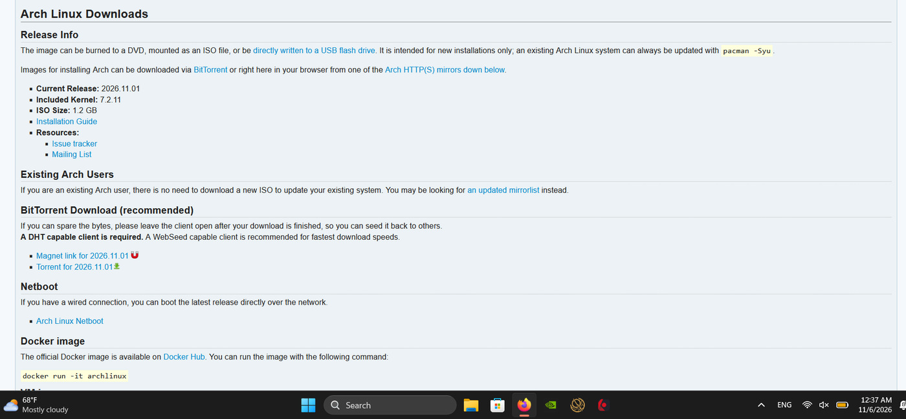

*Figure 1. The Arch Linux download page showing release 2026.11.01.*


### Step 2. Download the ISO

- **Direct download:** scroll to the **United States** mirror list, open a nearby mirror, and click `archlinux-2026.11.01-x86_64.iso`. Do not pick the `.sig` or `.torrent` files. A Dallas mirror was suggested: `https://dfw.mirror.rackspace.com/archlinux/iso/2026.11.01/`. A good backup is `https://mirrors.kernel.org/archlinux/iso/2026.11.01/`.
- **Torrent:** if you already have a torrent client, use the torrent or magnet link on the same page.

The file is saved to `C:\Users\nerot\Downloads`.


## Part 2: Verify the download

Checking the SHA256 hash proves the file is complete and unmodified. It takes a few seconds.


### Step 1. Open PowerShell in the Downloads folder

```
cd $HOME\Downloads
dir archlinux*
```

The listing should show `archlinux-2026.11.01-x86_64.iso` at 1,317,568,512 bytes (about 1.2 GB).

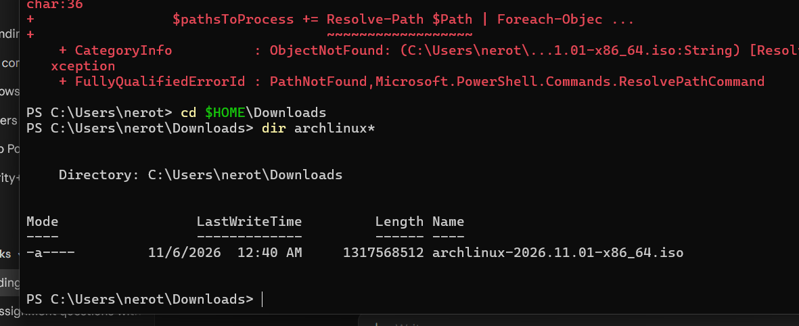

*Figure 2. PowerShell listing the ISO in the Downloads folder.*

> **Note:** If PowerShell says it cannot find the path, you are in the wrong folder. See Appendix A1.


### Step 2. Compute the hash

```
(Get-FileHash .\archlinux-2026.11.01-x86_64.iso -Algorithm SHA256).Hash
```

The result in this session was:

```
01BCDCF01AF2F7D58F2794899C834770D25C9BFC945BD092B32BB66672A4A216
```

This matches the SHA256 published on `archlinux.org/releng/releases/2026.11.01/` (case does not matter), so the ISO is intact and genuine. If the hashes ever differ, delete the file and download it again, ideally from a different mirror.


## Part 3: Create the virtual machine


### Step 1. Start the New VM wizard

Open VirtualBox and click **New**.

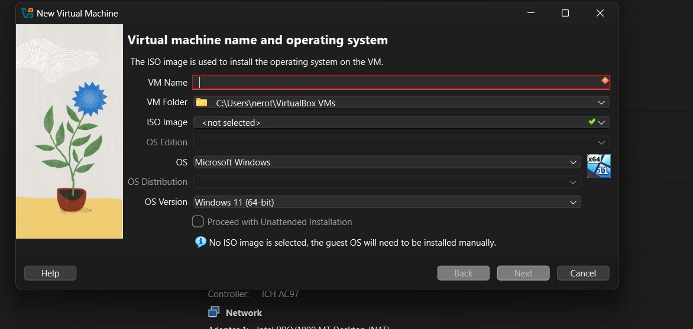

*Figure 3. The New Virtual Machine wizard before anything is filled in.*


### Step 2. Name the VM and attach the ISO

- **VM Name:** `ARCH`
- **ISO Image:** choose **Other...** and browse to `C:\Users\nerot\Downloads\archlinux-2026.11.01-x86_64.iso`. If the ISO does not appear, set the file type filter to **All files**.
- **OS:** Linux, **OS Distribution:** ArchLinux, **OS Version:** Arch Linux (64-bit)
- **Proceed with Unattended Installation:** leave it **unticked**. Arch has no unattended installer.

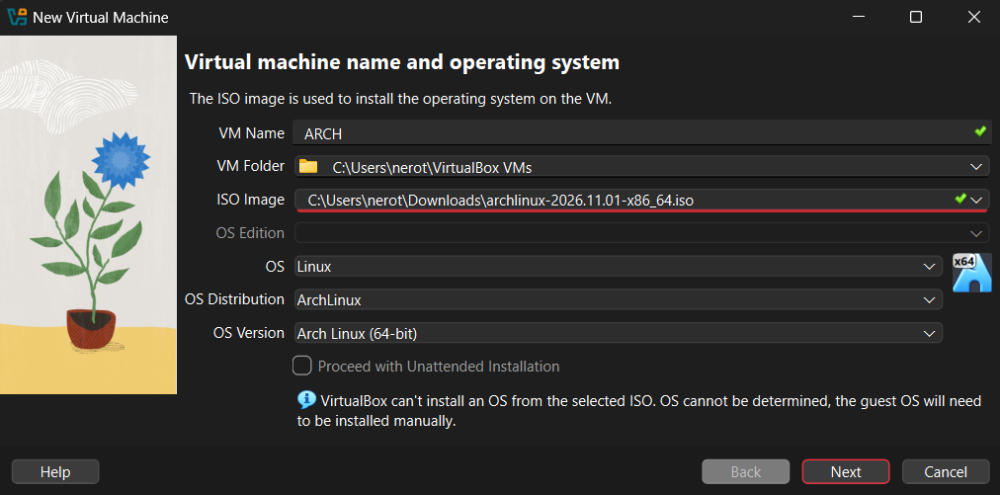

*Figure 4. Name, ISO, and OS fields filled in correctly.*

> **Note:** The blue message saying VirtualBox cannot install the OS from this ISO is normal for Arch. It only means you will run the installer yourself.


### Step 3. Set the hardware

The wizard's defaults were too large for RAM and CPUs, too small for the disk, and had EFI off:

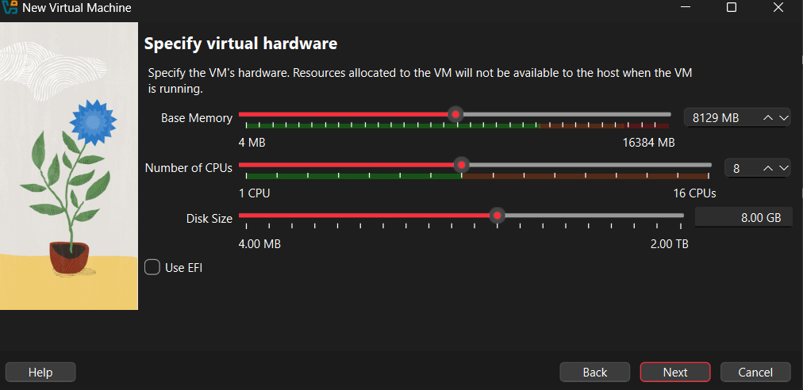

*Figure 5. Default values: 8129 MB RAM, 8 CPUs, 8 GB disk, EFI off.*

They were changed to the values below, which keep Windows responsive while the VM runs:

| Setting | Value |
|---|---|
| Base Memory | 4096 MB |
| Number of CPUs | 6 (inside the green safe range) |
| Disk Size | 30 GB |
| Use EFI | Ticked |

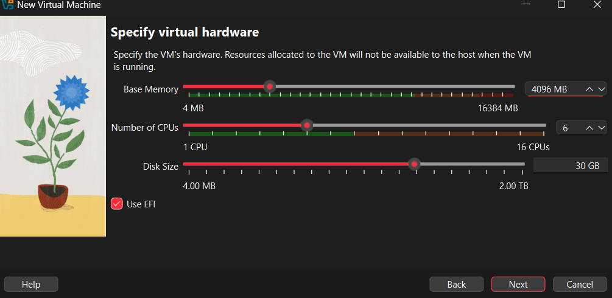

*Figure 6. Corrected hardware: 4096 MB, 6 CPUs, 30 GB disk, EFI enabled.*

Click **Next**, then **Finish**.


### Step 4. Check display and storage settings

Select the VM and open **Settings**. Set **Display > Video Memory** to **128 MB**. VirtualBox already uses the **VMSVGA** graphics controller for Linux guests. Under **Storage**, the ISO sits on the IDE controller and the 30 GB `ARCH.vdi` disk sits on the SATA controller, so the VM boots from the ISO first.

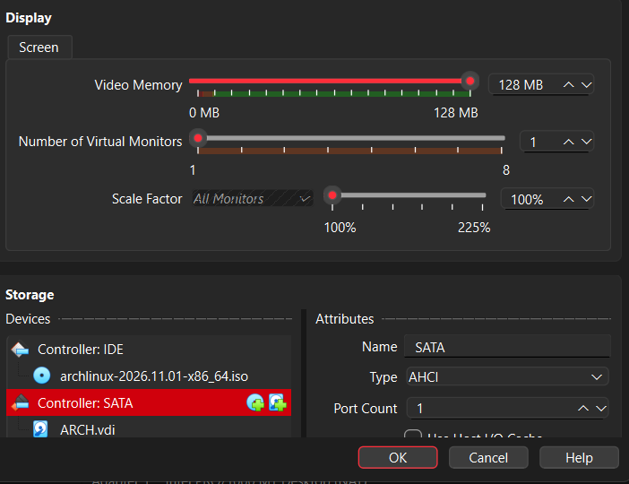

*Figure 7. Video memory at 128 MB; ISO on IDE and ARCH.vdi on SATA.*


## Part 4: Boot the installer


### Step 1. Start the VM

Click **Start**. VirtualBox may show a message about capturing the mouse and keyboard. Click **Capture**. Press **Right Ctrl** at any time to release them back to Windows.

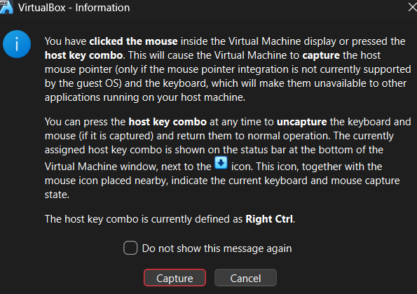

*Figure 8. The mouse and keyboard capture notice. Right Ctrl is the host key.*


### Step 2. Boot Arch

At the boot menu, press **Enter** on the first entry, *Arch Linux install medium*. A long list of green **OK** lines scrolls by while the live system starts. This is normal.

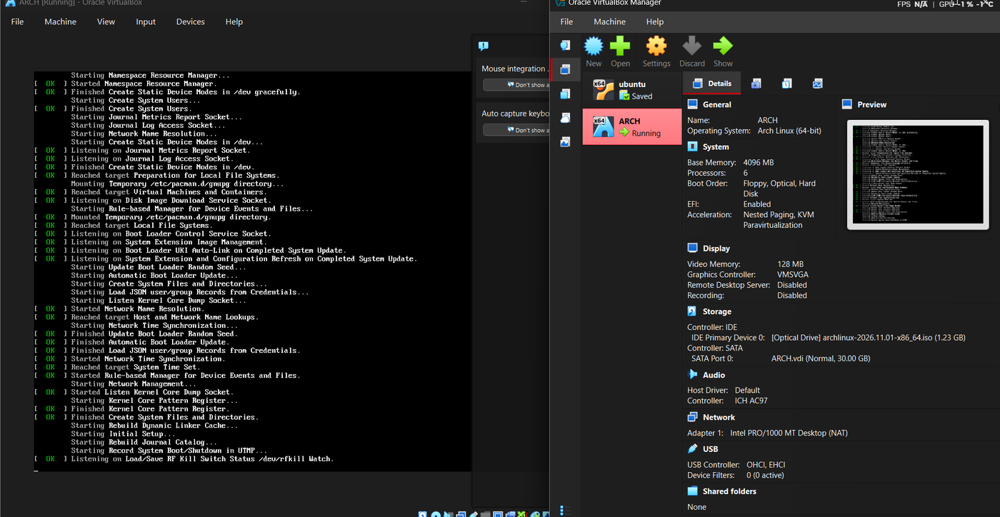

*Figure 9. The live installer booting inside VirtualBox.*

When you reach the `root@archiso ~ #` prompt, start the guided installer:

```
archinstall
```


## Part 5: Run archinstall

archinstall is a menu-driven installer. Use the arrow keys, **Enter** to select, and **Esc** to go back. The settings used in this session are listed in order below.


### Step 1. Authentication

Open **Authentication**. Ignore *U2F login setup*: "No U2F devices found" only means no hardware security key is plugged in, and none is needed.

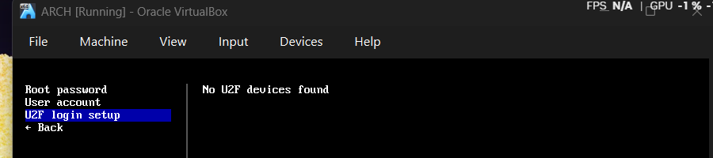

*Figure 10. The Authentication menu. U2F is not needed.*

- **Root password:** set and confirm a password. Characters are hidden as you type.
- **User account:** add the user `nero` and answer **Yes** to making it a superuser (sudo).


*Figure 11. Root password set and user `nero` created with sudo = True.*


### Step 2. Hostname

Set the hostname to `arch`.


*Figure 12. Hostname set to `arch`.*


### Step 3. Disk configuration

Choose **Disk configuration > Partitioning > Use a best-effort default partition layout**, then select the 30 GB virtual disk.

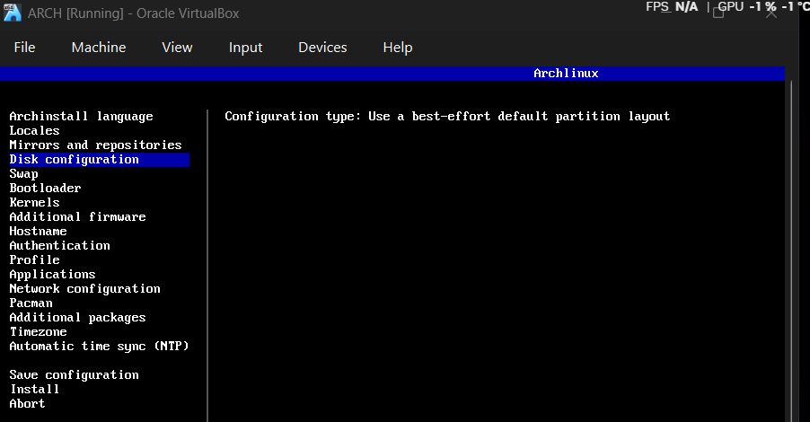

*Figure 13. Disk configuration set to the best-effort default layout.*

The resulting layout on `/dev/sda` (ATA VBOX HARDDISK, wiped) is:

| Partition | Size | Filesystem | Mount point |
|---|---|---|---|
| 1 (primary) | 1 GiB | fat32 | /boot |
| 2 (primary) | 29 GiB | ext4 | / |

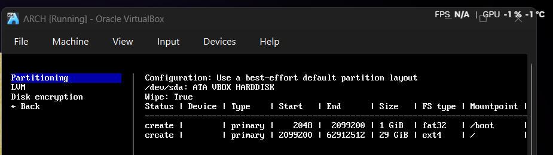

*Figure 14. Partition table: 1 GiB /boot (fat32) and 29 GiB / (ext4).*

> **Note:** The disk that gets wiped here is the 30 GB virtual disk inside VirtualBox, not the laptop's real drive.


### Step 4. Bootloader

Choose **Grub**. With **Removable** enabled, GRUB installs to the fallback EFI path, which is the most reliable choice under VirtualBox's EFI.

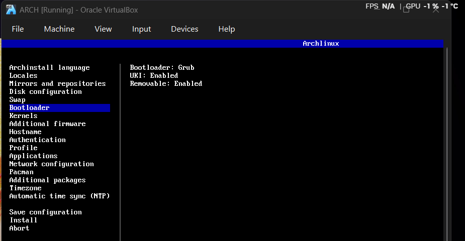

*Figure 15. Bootloader: Grub, UKI enabled, Removable enabled.*


### Step 5. Profile (KDE Plasma)

Open **Profile**, set the type to **Desktop > KDE Plasma**, and when asked for a flavor choose **plasma-meta (Recommended)**. It installs a complete Plasma desktop with the usual tools and apps.

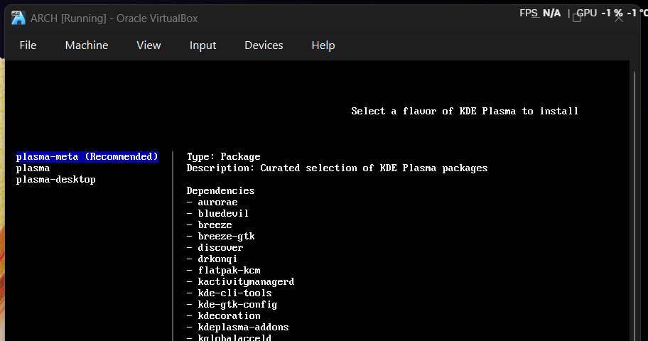

*Figure 16. Selecting plasma-meta, the recommended flavor.*

Back in the profile menu, the selected profile and the extra packages (`htop`, `nano`, `openssh`, `plasma-meta`, `smartmontools`, `vim`, `wget`, `xdg-utils`) are listed. Two more items need a choice here:

- **Graphics driver:** all open-source drivers. Do not use NVIDIA inside a VM, because it cannot reach the real GPU.
- **Greeter:** `sddm`, the standard KDE login screen.

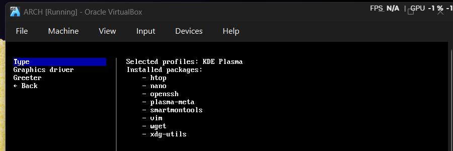

*Figure 17. Profile menu with KDE Plasma selected.*


### Step 6. Network and audio

**Network configuration** was left at *Copy ISO network configuration to installation*, so the installed system reuses the VM's working connection. Under **Applications**, set audio to **pipewire**.

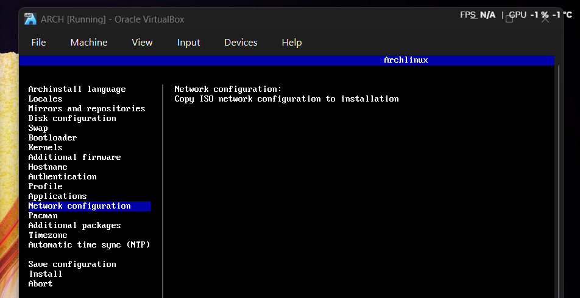

*Figure 18. The main menu with network configuration highlighted.*


### Step 7. Install

Select **Install** at the bottom of the main menu and confirm. Packages are downloaded and installed; in this session it finished in **11 minutes 36 seconds**. When it asks what to do next:

- Choose **Exit archinstall**. Do not choose chroot.
- At the prompt, type `shutdown now`.

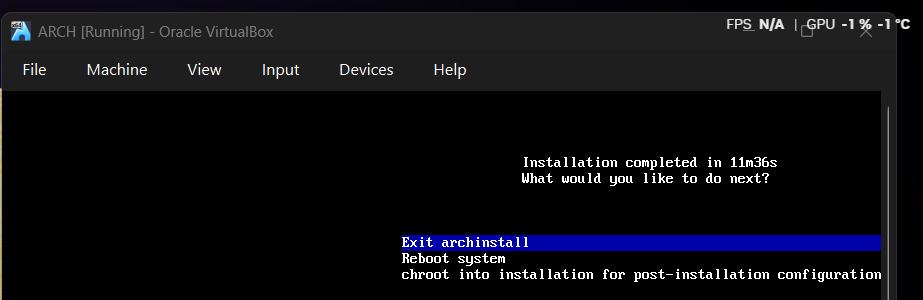

*Figure 19. Installation completed in 11m36s.*

> **Note:** **Not confirmed by screenshots:** the graphics driver choice (open-source), the sddm greeter, and pipewire audio were recommended during the session, but their screens were not captured.


## Part 6: Remove the ISO and first boot


### Step 1. Detach the ISO

With the VM shut down, open **Settings > Storage**. Under **Controller: IDE**, click the ISO entry, then click the red remove icon at the bottom of the device list. Leave `ARCH.vdi` under SATA alone, because that is the installed system.

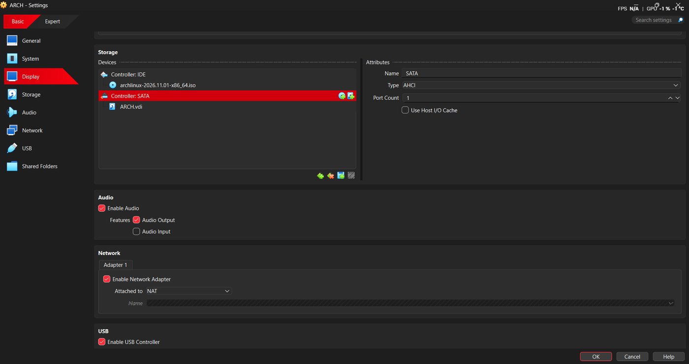

*Figure 20. Storage settings: the ISO is under Controller: IDE; ARCH.vdi is under SATA.*

VirtualBox asks whether to delete the optical drive. Click **Remove**. This is safe, because the guest tools come from `pacman` inside Arch rather than from a disc.

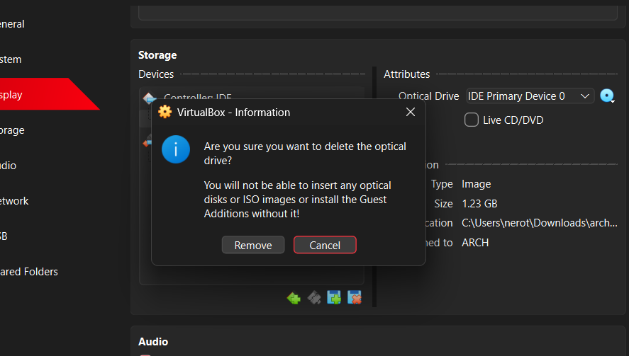

*Figure 21. Confirming removal of the optical drive.*

Click **OK** to save the settings.


### Step 2. Boot into the new system

Select **ARCH** and click **Start**. The VM now boots from the virtual disk through GRUB and lands on the KDE Plasma desktop. Log in as `nero`.

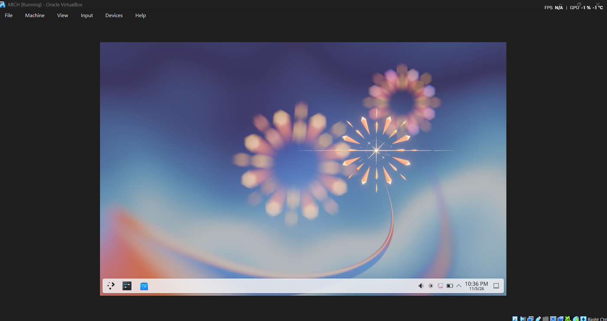

*Figure 22. The installed Arch Linux system running KDE Plasma.*

> **Note:** If the VM boots back into the installer menu, the ISO is still attached. Repeat Step 1.


## Part 7: Recommended steps after first boot

These were recommended after the screenshots above and are not captured in them. Open **Konsole** (the terminal) and run:


### Step 1. Install VirtualBox guest tools

```
sudo pacman -S virtualbox-guest-utils
sudo systemctl enable --now vboxservice
```

Reboot afterwards. This gives you automatic screen resizing and a shared clipboard between Windows and Arch.


### Step 2. Update the system

```
sudo pacman -Syu
```

> **Tip:** Arch is a rolling release. Run the update command regularly; the monthly ISO is only for new installs.


## Part 8: Optional, install Arch directly on the Legion

This was not performed in this session. It is the plan if you later want Arch on the real hardware for gaming or GPU use. The ISO you downloaded and verified in Parts 1 and 2 can be reused as is.


### Step 1. Flash a USB stick

- Use a USB stick of 8 GB or more. Everything on it will be erased.
- Download **Rufus** from `rufus.ie`, select the ISO, set the partition scheme to **GPT**, click **START**, and choose **Write in DD Image mode**.


### Step 2. Boot from it

- Restart and tap **F2** to open BIOS. Turn **Secure Boot off**, because the Arch ISO is not signed.
- If the installer cannot see the drive, switch the storage mode from Intel RST/VMD to **AHCI**.
- Restart and tap **F12** to open the boot menu, then pick the USB stick. Some Legions also have a Novo button.


### Step 3. Install

- Connect to Wi-Fi: `iwctl`, then `station wlan0 connect "YourSSID"`. Skip this on Ethernet.
- Run `archinstall`. This time choose the **NVIDIA** driver under graphics.
- If you want to keep Windows, shrink its partition first and turn off BitLocker and Fast Startup. Back up your files before touching partitions.

> **Warning:** Installing on the real drive can erase data. Unlike the VM, mistakes here are not easy to undo.


## Appendix A: Troubleshooting


### A1. PowerShell says it cannot find the ISO path

The command was run from `C:\Users\nerot` instead of the Downloads folder, so `.\archlinux-...iso` pointed at a file that was not there.

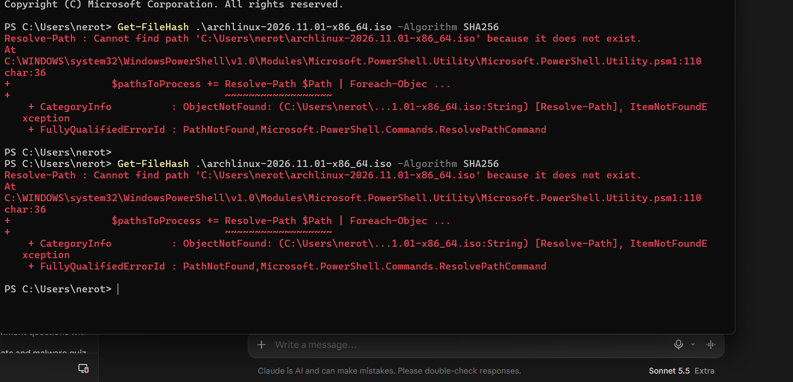

*Figure 23. Resolve-Path error caused by running the command in the wrong folder.*

**Fix:** move into the Downloads folder first, then repeat the command.

```
cd $HOME\Downloads
dir archlinux*
```


### A2. VirtualBox cannot see the ISO in the file dialog

The dialog was titled *Select a virtual machine file* and filtered to `*.xml *.vbox`, which hides ISO files. That is the dialog for importing an existing VM, not for choosing an ISO.

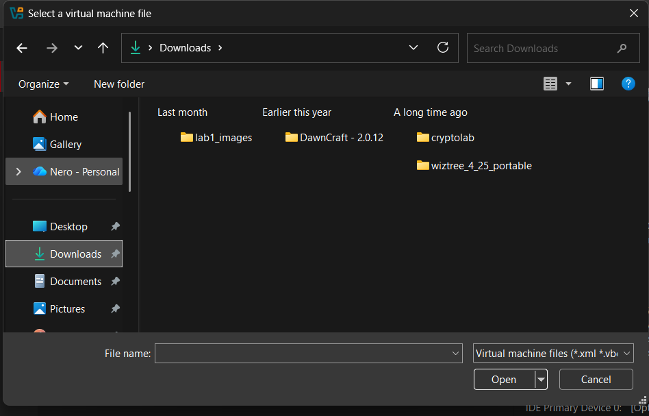

*Figure 24. The wrong dialog: it only shows VM files, so the ISO is hidden.*

**Fix:** cancel it and pick the ISO from the **ISO Image** dropdown in the New VM wizard (**Other...**), or from **Settings > Storage** on the optical drive, and set the file type to **All files**.


### A3. Other issues and quick fixes

| Symptom | Likely cause and fix |
|---|---|
| Black screen or `Shell>` prompt on boot | Type `exit`, choose **Boot Manager**, then pick the CD/DVD entry. |
| VM boots back into the installer | The ISO is still attached. Remove it under Settings > Storage. |
| Hash does not match | Incomplete or corrupt download. Delete the file and re-download from another mirror. |
| Install fails while downloading packages | Check the VM's network (NAT) and retry the install. |
| Mouse stuck in the VM window | Press **Right Ctrl** to release it. |
